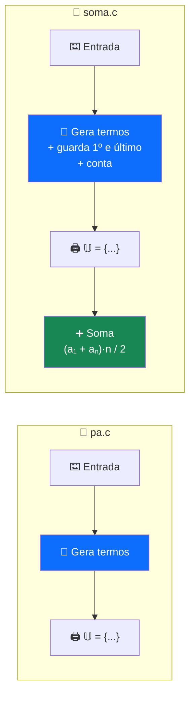
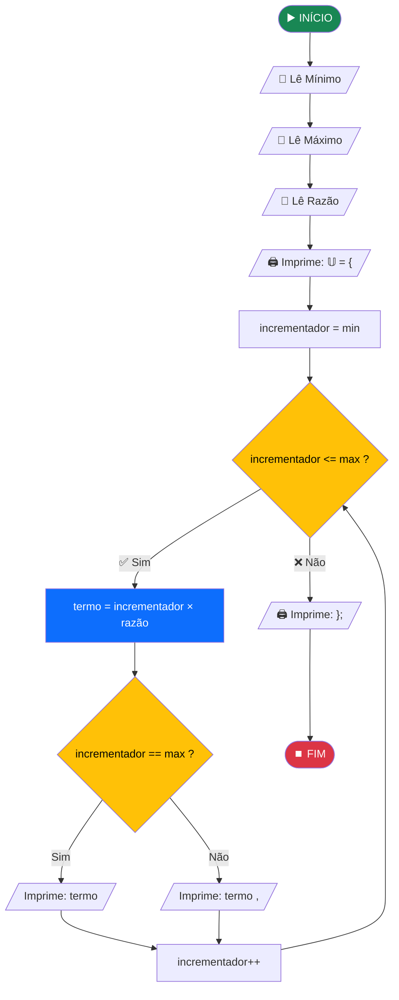
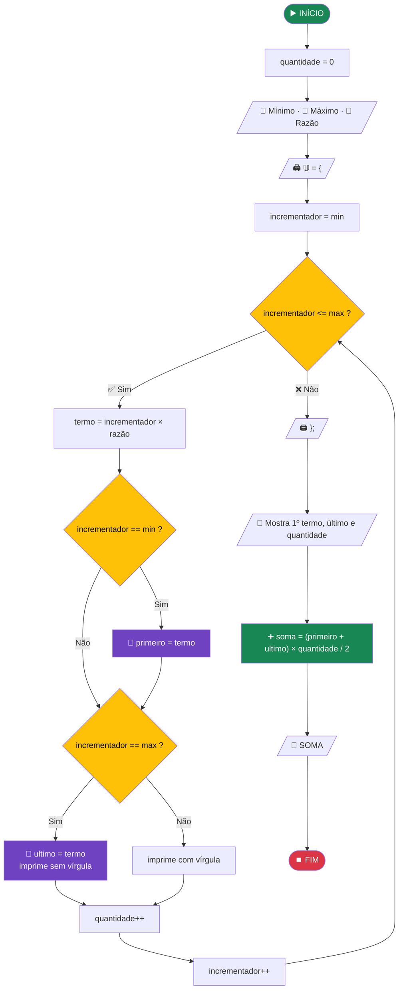

<div align="center">

# 🔢 Progressão Aritmética em C

**Dois programas de terminal: um gera os termos de uma Progressão Aritmética (P.A.) e o outro, além de gerar, calcula a soma de todos eles**


-2ea44f?style=for-the-badge)

```
  ┌──────────────────────────────────────────────────────┐
  │  🔹 Mínimo: 1                                        │
  │  🔸 Máximo: 5                                        │
  │  💠 Razão: 3                                         │
  │  𝕌 = {3 , 6 , 9 , 12 , 15};                          │
  │  ──────────────────────────────────────────────────  │
  │  📌 1°) Termo: 3                                     │
  │  📌 n°) Termo: 15                                    │
  │  📌 quantidade: 5                                    │
  │  📍 SOMA: 45                                         │
  └──────────────────────────────────────────────────────┘
```

</div>

---

## 📑 Sumário

1. [Visão geral](#-visão-geral)
2. [O que é uma Progressão Aritmética](#-o-que-é-uma-progressão-aritmética)
3. [Estrutura do projeto](#-estrutura-do-projeto)
4. [Como compilar e executar](#-como-compilar-e-executar)
5. [Como os termos são gerados](#-como-os-termos-são-gerados)
6. [Programa 1: pa.c](#-programa-1-pac)
7. [Programa 2: soma.c](#-programa-2-somac)
8. [A fórmula da soma, visualmente](#-a-fórmula-da-soma-visualmente)
9. [Teste de mesa completo](#-teste-de-mesa-completo)
10. [Exemplos de execução](#-exemplos-de-execução)
11. [Casos limite](#-casos-limite)
12. [Análise de complexidade](#-análise-de-complexidade)
13. [Possíveis melhorias](#-possíveis-melhorias)

---

## 🎯 Visão geral

| | 📄 `pa.c` | 📄 `soma.c` |
|---|:-:|:-:|
| Lê mínimo, máximo e razão | ✅ | ✅ |
| Gera e imprime os termos da P.A. | ✅ | ✅ |
| Guarda o primeiro e o último termo | — | ✅ |
| Conta quantos termos existem | — | ✅ |
| Calcula a soma pela fórmula de Gauss | — | ✅ |



> 💡 O `soma.c` é uma **evolução** do `pa.c`: tem o mesmo laço, com três informações extras coletadas durante a repetição.

---

## 📐 O que é uma Progressão Aritmética

É uma sequência de números em que **cada termo é o anterior somado a um valor fixo**, chamado **razão (r)**.

```
   3  ──+3──▶  6  ──+3──▶  9  ──+3──▶  12  ──+3──▶  15
   a₁          a₂          a₃          a₄           a₅
```

| Fórmula | Significado |
|---|---|
| `aₙ = a₁ + (n − 1) · r` | Termo geral: encontra qualquer termo |
| `Sₙ = (a₁ + aₙ) · n / 2` | Soma dos `n` primeiros termos |

---

## 📁 Estrutura do projeto

```
PA/
├── 📘 README.md
├── 📝 runner.txt    → comandos para compilar e rodar cada programa
├── 📄 pa.c          → gera os termos da P.A.
├── ⚙️ pa.exe
├── 📄 soma.c        → gera os termos e calcula a soma
└── ⚙️ soma.exe
```

---

## 🚀 Como compilar e executar

### Pré-requisitos

- **GCC** no Windows (via [MinGW-w64](https://www.mingw-w64.org/) ou [MSYS2](https://www.msys2.org/))
- Terminal **PowerShell**

### Comandos (os mesmos do `runner.txt`)

```powershell
# 📄 P.A.
clear; chcp 65001; gcc.exe pa.c -o pa.exe; .\pa.exe;

# ➕ SOMA
clear; chcp 65001; gcc.exe soma.c -o soma.exe; .\soma.exe;
```


> 🔤 O `chcp 65001` é essencial: sem ele, os emojis 🔹🔸💠 e o símbolo **𝕌** (conjunto universo) aparecem como caracteres estranhos no console do Windows.

### Linux / macOS

```bash
gcc pa.c -o pa && ./pa
gcc soma.c -o soma && ./soma
```

---

## 🧩 Como os termos são gerados

Este é o ponto mais importante para entender os dois programas.

> 🔑 **Mínimo** e **Máximo** não são os valores da sequência: são os **multiplicadores** da razão.
> Cada termo é calculado como **`termo = incrementador × razão`**, com o incrementador indo de `min` até `max`.

```
   Entrada:  Mínimo = 1   Máximo = 5   Razão = 3

   incrementador:    1      2      3      4      5
                     │      │      │      │      │
                   × 3    × 3    × 3    × 3    × 3
                     │      │      │      │      │
                     ▼      ▼      ▼      ▼      ▼
   termo:            3      6      9     12     15

   𝕌 = {3 , 6 , 9 , 12 , 15}
```

Por isso a sequência gerada é sempre uma P.A. de **múltiplos da razão**:

| Parâmetro da P.A. | Valor no programa |
|---|---|
| Primeiro termo (a₁) | `min × razão` |
| Último termo (aₙ) | `max × razão` |
| Razão (r) | `razão` |
| Quantidade de termos (n) | `max − min + 1` |

```
   Mínimo = 3   Máximo = 7   Razão = 5

   3×5   4×5   5×5   6×5   7×5
   ─┬─   ─┬─   ─┬─   ─┬─   ─┬─
   15    20    25    30    35       →  começa em 15, não em 3
```

---

## 📄 Programa 1: `pa.c`

### Fluxograma



### O código, bloco por bloco

```c
int min;            // 🔹 primeiro multiplicador
int max;            // 🔸 último multiplicador
int razao;          // 💠 razão da P.A.
int incrementador;  // 🔁 contador do laço
```

```c
printf("🔹 Mínimo: ");  scanf("%d",&min);
printf("🔸 Máximo: ");  scanf("%d",&max);
printf("💠 Razão: ");   scanf("%d",&razao);
```

```c
printf("𝕌 = {");                                              // ① abre o conjunto
for(incrementador = min; incrementador <= max; incrementador++){
    int termo = incrementador * razao;                        // ② calcula o termo
    if(incrementador == max)
        printf("%d",termo);                                   // ③ último: sem vírgula
    else
        printf("%d , ",termo);                                //    demais: com vírgula
}
printf("};");                                                 // ④ fecha o conjunto
```

### 🎯 O truque da vírgula

O `if` dentro do laço existe só para que o **último termo não tenha vírgula depois dele**:

```
   Sem o if:   𝕌 = {3 , 6 , 9 , 12 , 15 , };     ❌ vírgula sobrando
   Com o if:   𝕌 = {3 , 6 , 9 , 12 , 15};        ✅
                                      ▲
                          incrementador == max → imprime sem " , "
```

### Montagem da saída, volta por volta

```
   antes do for :  𝕌 = {
   volta 1      :  𝕌 = {3 ,
   volta 2      :  𝕌 = {3 , 6 ,
   volta 3      :  𝕌 = {3 , 6 , 9 ,
   volta 4      :  𝕌 = {3 , 6 , 9 , 12 ,
   volta 5      :  𝕌 = {3 , 6 , 9 , 12 , 15
   depois do for:  𝕌 = {3 , 6 , 9 , 12 , 15};
```

---

## ➕ Programa 2: `soma.c`

### Fluxograma



### O que muda em relação ao `pa.c`

```diff
  int min, max, razao, incrementador;
+ int quantidade = 0;          // conta os termos
+ int primeiro, ultimo;        // a₁ e aₙ
+ int soma;                    // resultado final

  for(incrementador=min; incrementador <= max; incrementador++)
  {
      int termo = incrementador * razao;
+     if(incrementador == min)
+         primeiro = termo;    // guarda o 1º termo
      if(incrementador == max)
      {
+         ultimo = termo;      // guarda o último termo
          printf("%d",termo);
      }
      else
          printf("%d , ",termo);
+     quantidade = quantidade + 1;
  }

+ soma = ((primeiro + ultimo) * (quantidade))/2;
```

### Três informações coletadas em uma única passagem

```
   ┌──────────────────────── for (min → max) ─────────────────────────┐
   │                                                                  │
   │   1ª volta ──▶ 📌 primeiro = termo                               │
   │                                                                  │
   │   toda volta ─▶ 🔢 quantidade++                                  │
   │                                                                  │
   │   última volta ▶ 📌 ultimo = termo                               │
   │                                                                  │
   └──────────────────────────────────────────────────────────────────┘
                                   │
                                   ▼
                  ➕ soma = (primeiro + ultimo) × quantidade / 2
```

---

## 🧠 A fórmula da soma, visualmente

### A ideia de Gauss

Diz a história que o matemático **Carl Friedrich Gauss**, ainda criança, somou de 1 a 100 em segundos percebendo que **o primeiro + o último**, **o segundo + o penúltimo** etc. **sempre dão o mesmo valor**.

Aplicando à sequência `𝕌 = {3, 6, 9, 12, 15}`:

```
   Sequência normal:     3     6     9    12    15
   Sequência invertida: 15    12     9     6     3
                        ───   ───   ───   ───   ───
   Soma de cada par:    18    18    18    18    18     ← sempre a₁ + aₙ

   5 pares de 18  =  90   →  isso é o DOBRO da soma
   90 ÷ 2         =  45   ✅
```

```
   Sₙ  =  (a₁ + aₙ) × n  /  2
        =  ( 3 + 15) × 5  /  2
        =     18   × 5  /  2
        =        90     /  2
        =        45
```

### Visualização com blocos

Cada termo é uma coluna. Juntando a sequência com ela mesma invertida, forma-se um **retângulo** de altura `a₁ + aₙ` e largura `n`. A soma é **metade** dele:

```
        █ = sequência original      ░ = sequência invertida

   18 ┤ ░░  ░░  ░░  ░░  ░░
   15 ┤ ░░  ░░  ░░  ░░  ██
   12 ┤ ░░  ░░  ░░  ██  ██
    9 ┤ ░░  ░░  ██  ██  ██
    6 ┤ ░░  ██  ██  ██  ██
    3 ┤ ██  ██  ██  ██  ██
      └─┬───┬───┬───┬───┬──
       a₁  a₂  a₃  a₄  a₅
        3   6   9  12  15   ← altura de cada █

   Retângulo = 18 × 5 = 90   →   metade (█) = 45
```

---

## 📋 Teste de mesa completo

Entrada: **Mínimo = 1 · Máximo = 5 · Razão = 3** (no `soma.c`)

| Volta | `incrementador` | `<= max`? | `termo` | `== min`? | `== max`? | `primeiro` | `ultimo` | `quantidade` | Impresso |
|:-:|:-:|:-:|:-:|:-:|:-:|:-:|:-:|:-:|:--|
| — | — | — | — | — | — | ? | ? | 0 | `𝕌 = {` |
| 1 | 1 | ✅ | **3** | ✅ | ❌ | **3** | ? | 1 | `3 , ` |
| 2 | 2 | ✅ | **6** | ❌ | ❌ | 3 | ? | 2 | `6 , ` |
| 3 | 3 | ✅ | **9** | ❌ | ❌ | 3 | ? | 3 | `9 , ` |
| 4 | 4 | ✅ | **12** | ❌ | ❌ | 3 | ? | 4 | `12 , ` |
| 5 | 5 | ✅ | **15** | ❌ | ✅ | 3 | **15** | 5 | `15` |
| — | 6 | ❌ | — | — | — | 3 | 15 | **5** | `};` |

Cálculo final:

```
   soma = (3 + 15) × 5 / 2 = 45      📍 SOMA: 45
```

### Memória ao final da execução

```
   ┌──────────────┬───────┐
   │ min          │   1   │
   │ max          │   5   │
   │ razao        │   3   │
   │ incrementador│   6   │  ← parou ao passar do max
   ├──────────────┼───────┤
   │ primeiro     │   3   │
   │ ultimo       │  15   │
   │ quantidade   │   5   │
   │ soma         │  45   │
   └──────────────┴───────┘
```

---

## 💻 Exemplos de execução

Saídas reais dos programas compilados:

| Mínimo | Máximo | Razão | 𝕌 gerado | 1º | Último | Qtd. | Soma |
|:-:|:-:|:-:|:--|:-:|:-:|:-:|:-:|
| 1 | 5 | 3 | `{3 , 6 , 9 , 12 , 15}` | 3 | 15 | 5 | **45** |
| 1 | 10 | 2 | `{2 , 4 , 6 , ... , 18 , 20}` | 2 | 20 | 10 | **110** |
| 3 | 7 | 5 | `{15 , 20 , 25 , 30 , 35}` | 15 | 35 | 5 | **125** |
| 0 | 4 | 10 | `{0 , 10 , 20 , 30 , 40}` | 0 | 40 | 5 | **100** |
| 1 | 5 | −2 | `{-2 , -4 , -6 , -8 , -10}` | −2 | −10 | 5 | **−30** |
| 5 | 5 | 7 | `{35}` | 35 | 35 | 1 | **35** |

### `pa.c`

```console
🔹 Mínimo: 1
🔸 Máximo: 10
💠 Razão: 2
𝕌 = {2 , 4 , 6 , 8 , 10 , 12 , 14 , 16 , 18 , 20};
```

### `soma.c`

```console
🔹 Mínimo: 3
🔸 Máximo: 7
💠 Razão: 5
𝕌 = {15 , 20 , 25 , 30 , 35};
__________________________________________________________________________________
|--------------| SOMA DOS N TERMOS DE UMA PROGRASSÃO ARITIMÉTRICA |--------------|
📌 1°) Termo: 15
📌 n°) Termo: 35
📌 quantidade: 5
📍 SOMA: 125
```

---

## 🚨 Casos limite

| Situação | Exemplo | Comportamento | |
|---|:-:|---|:-:|
| Entrada normal | `1 · 5 · 3` | Funciona corretamente | ✅ |
| Razão negativa | `1 · 5 · -2` | Gera P.A. decrescente: `{-2 , ... , -10}` | ✅ |
| Razão zero | `1 · 5 · 0` | P.A. constante: `{0 , 0 , 0 , 0 , 0}` | ✅ |
| Mínimo = Máximo | `5 · 5 · 7` | Um único termo: `{35}` | ✅ |
| **Mínimo > Máximo** | `5 · 1 · 2` | O laço não executa e o `soma.c` mostra **lixo de memória** | ❌ |
| Letra na entrada | `a` | Comportamento indefinido | ❌ |
| Valores muito grandes | razão `100000`, máx. `100000` | Estouro de `int` no termo e na soma | ❌ |

### 🔴 Mínimo maior que o máximo (`soma.c`)

Saída real com `Mínimo = 5`, `Máximo = 1`:

```console
𝕌 = {};
📌 1°) Termo: -501892368     ← lixo de memória
📌 n°) Termo: 32744          ← lixo de memória
📌 quantidade: 0
📍 SOMA: 0
```

Como o laço nunca roda, `primeiro` e `ultimo` **nunca recebem valor**. Em C, variáveis locais sem inicialização guardam o que já estava naquela posição da memória.

---

## 📊 Análise de complexidade

Com `n = max − min + 1` termos:

| Métrica | `pa.c` | `soma.c` |
|---|:-:|:-:|
| **Tempo** | `O(n)` | `O(n)` |
| **Espaço** | `O(1)` | `O(1)` |
| Multiplicações | `n` | `n + 1` |
| Chamadas a `printf` | `n + 5` | `n + 11` |

> 💡 A soma em si é `O(1)`: usa a fórmula em vez de somar termo a termo. O laço é `O(n)` porque precisa **imprimir** cada termo.

---

## 🛠️ Possíveis melhorias

| # | Melhoria | Benefício |
|:-:|---|---|
| 1 | Validar `min <= max` antes do laço | Elimina o lixo de memória |
| 2 | Inicializar `primeiro = 0` e `ultimo = 0` | Valores previsíveis mesmo em caso de erro |
| 3 | Verificar o retorno do `scanf` | Evita comportamento indefinido com letras |
| 4 | Usar `long long` para `termo` e `soma` | Suporta sequências muito maiores |
| 5 | Calcular `quantidade = max - min + 1` direto | Mostra a relação matemática sem precisar contar |
| 6 | Corrigir o texto para "PROGRESSÃO ARITMÉTICA" | Título correto na saída |
| 7 | Adicionar `\n` no final dos `printf` | O prompt do terminal não fica grudado na saída |
| 8 | Remover `stdlib.h`, `string.h` e `math.h` | Só `stdio.h` é usada |
| 9 | Juntar os dois programas em um menu | Um único executável com as duas opções |

<details>
<summary><b>👉 Clique para ver uma versão do soma.c com as melhorias aplicadas</b></summary>

```c
#include <stdio.h>

int main(void)
{
    int min, max, razao;

    printf("🔹 Mínimo: ");
    if (scanf("%d", &min) != 1) { printf("❌ Valor inválido.\n"); return 1; }

    printf("🔸 Máximo: ");
    if (scanf("%d", &max) != 1) { printf("❌ Valor inválido.\n"); return 1; }

    printf("💠 Razão: ");
    if (scanf("%d", &razao) != 1) { printf("❌ Valor inválido.\n"); return 1; }

    if (min > max) {
        printf("❌ O mínimo não pode ser maior que o máximo.\n");
        return 1;
    }

    long long primeiro   = (long long)min * razao;
    long long ultimo     = (long long)max * razao;
    long long quantidade = (long long)max - min + 1;

    printf("𝕌 = {");
    for (int i = min; i <= max; i++) {
        printf(i == max ? "%lld" : "%lld , ", (long long)i * razao);
    }
    printf("};\n");

    long long soma = (primeiro + ultimo) * quantidade / 2;

    printf("__________________________________________________________________\n");
    printf("|--------| SOMA DOS N TERMOS DE UMA PROGRESSÃO ARITMÉTICA |--------|\n");
    printf("📌 1°) Termo: %lld\n", primeiro);
    printf("📌 n°) Termo: %lld\n", ultimo);
    printf("📌 quantidade: %lld\n", quantidade);
    printf("📍 SOMA: %lld\n", soma);
    return 0;
}
```

</details>

---

<div align="center">

**Projeto em C para estudo de laços `for`, condicionais e Progressão Aritmética** 📚

`pa.c` gera · `soma.c` gera e soma · `Sₙ = (a₁ + aₙ) · n / 2` ➕

</div>